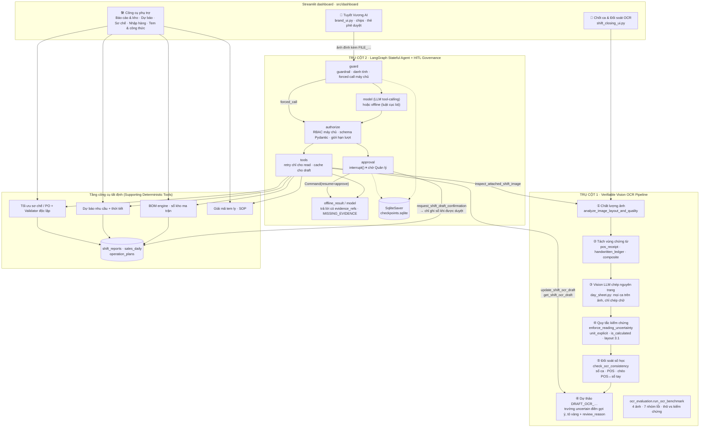

# Nghiên cứu và phát triển hệ thống AI Agent dựa trên bằng chứng tích hợp nhận dạng chứng từ viết tay và hóa đơn POS (Vision OCR) hỗ trợ tự động hóa đối soát và vận hành cửa hàng đồ uống

> **Đồ án tốt nghiệp** · Hệ thống triển khai: **BeverageOps AI — Mixue 39 Tôn Quang Phiệt** (mã cửa hàng `MX-2132`)
> Địa chỉ: Số 39 Tôn Quang Phiệt, P. Cổ Nhuế 1, Q. Bắc Từ Liêm, Hà Nội · Chủ quán: Nguyễn Hạnh Chi · Quản lý: Bùi Văn Quang
> Nguyên tắc: **Evidence-driven** · **Verifiable OCR** · **Human-in-the-Loop** · **RBAC phía máy chủ**

Khoảng 85% trọng tâm kỹ thuật của đồ án nằm ở **hai trụ cột**. Các phân hệ thống kê, sổ kho, dự báo, tối ưu sơ chế/nhập hàng và giải mã tem ly là **công cụ tất định phụ trợ (supporting deterministic tools)**: chúng cung cấp dữ liệu có nguồn gốc cho Agent và cho bước đối soát, không phải trọng tâm nghiên cứu.

| | Trụ cột 1 — Verifiable Vision OCR | Trụ cột 2 — Stateful AI Operations Agent |
|---|---|---|
| Bài toán | Đọc sổ chốt ca **viết tay** và **hóa đơn POS** mà không để số sai lọt vào sổ doanh thu | Trả lời & hành động trên dữ liệu cửa hàng **có bằng chứng**, có người phê duyệt |
| Mã nguồn | `src/engine/vision_ocr.py`, `src/engine/ocr_evaluation.py`, `src/engine/shift_service.py`, `src/dashboard/shift_closing_ui.py`, `src/dashboard/ocr_components.py` | `src/agent/graph_runtime.py`, `src/agent/graph_tools.py`, `src/agent/response_policy.py`, `src/agent/mixue_agent.py`, `src/auth.py`, `src/dashboard/brand_ui.py` |
| Điểm nhấn | Tách vùng `pos_receipt` / `handwritten_ledger` / `composite`; kiểm tra ảnh mờ; `unit_explicit` (không tự nhân 1.000); `is_calculated` (`962 + 629`); chặn bảng đếm cốc `3.1`; `uncertain` + `review_reason`; đối soát số học chéo sổ tay ↔ POS; benchmark 7 nhóm lỗi | Đồ thị LangGraph (`guard` → `model`/`offline` → `authorize` → `tools` → `approval`); `interrupt()` / `Command(resume=…)`; `SqliteSaver`; `MISSING_EVIDENCE`; RBAC máy chủ; 3 công cụ OCR trong hội thoại |
| Trên giao diện | **📸 Chốt Ca & Đối Soát OCR (Chữ viết tay & POS)** | **💬 Tuyết Vương AI (LangGraph Agent)** |

---

## 1. Kiến trúc



### 1.1. Trụ cột 1 — Verifiable Vision OCR

Mô hình Vision chỉ là **bộ chép chữ**; quyết định một con số có được vào biểu mẫu hay không nằm ở tầng kiểm chứng tất định (`src/engine/day_sheet.py`, `src/engine/vision_ocr.py`).

**Đọc cả trang, một lần cho mọi ca** (`day_sheet.py`) — học theo cách các trợ lý đa phương thức đọc bảng viết tay tốt nhất:

1. Ảnh được dựng thẳng theo EXIF, tăng tương phản nhẹ và phóng lên cạnh dài ≥ 1600 px trước khi gửi (ảnh điện thoại 768×1024 chữ viết tay nhỏ).
2. Mô hình **chép toàn trang trước** (`transcription`, từng hàng "nhãn in sẵn | chữ viết tay"), rồi chép **nguyên văn** từng ô cho **mọi mục ca có trên ảnh** (`1. Ca sáng`, `2. Ca chiều`, `3. Ca tối` = 3.2 + 4 + 5) và phiếu POS nếu có — kèm mức đọc được `clear/unsure/illegible/empty`. Mô hình **không quy đổi, không cộng**.
3. `parse_cell` (tất định) đổi chữ thành tiền: `653` → 653.000 (số tắt), `962 + 629` → 1.591.000, `2014 (dư20k)` → tiền mặt 2.014.000 + dư 20.000, `41k …; 15k …` → khoản chi 56.000. Mọi quy đổi/cộng vẫn bị đánh dấu ⚠️ để người xác nhận.
4. Một lần đọc được **lưu theo ảnh**: đổi ca trên màn hình (hoặc nhắn `đọc lại ảnh cho ca chiều` trong chat) không gọi lại mô hình. Ảnh không chứa ca đang chọn được đánh dấu, không trộn vào báo cáo của ca đó.
5. Kiểm thử trên bản chép của 3 ảnh thật ngày 14/10/2026 (`data/ocr_eval/day_sheet_transcripts.json`, `tests/test_day_sheet.py`): cả 33 ô của 3 ca khớp báo cáo đã duyệt. Đây là phép đo tầng quy tắc trên bản chép mô phỏng, không phải độ chính xác của mô hình.

| Quy tắc | Hành vi | Ví dụ |
|---|---|---|
| Chất lượng ảnh | `analyze_image_layout_and_quality` đo độ tương phản/cạnh; ảnh mờ → mọi trường `uncertain` | Phiếu POS mờ: không tin `9,057,300` |
| Nguồn chứng từ | Mỗi trường mang `source` (`pos_receipt`, `handwritten_ledger`, `both_conflicting`); ảnh ghép không cho số POS lọt vào ô sổ ca | `1.Cash 9,657,300` không điền vào *Tiền mặt ca sáng* |
| Đơn vị viết tay | `unit_explicit=False` với số trần như `653`, `2328`, `5,466` → số đọc giữ nguyên, không công nhận là đã đọc; biểu mẫu điền **gợi ý ×1.000 tô vàng** | `653` → ⚠️ gợi ý 653.000, chờ xác nhận |
| Biểu thức | `is_calculated=True` với `962 + 629` → giữ nguyên chuỗi, **không tự cộng** | `bank_transfer_formula = "962 + 629"` |
| Bố cục | Số trong bảng đếm cốc/quà tặng (mục `3.1`) hoặc dòng ví dụ in sẵn bị chặn | `còn lại 899` không thành khoản chi |
| Đối soát số học | Cộng ngang sổ ca, tổng thành phần POS, chéo sổ tay ↔ POS; **giữ nguyên số đọc**, chỉ cảnh báo | Lệch `-110,000 đ` trên POS do `5,837` thay vì `115,837` |
| Người xác nhận | Trường `uncertain` được điền gợi ý, tô vàng kèm `review_reason`; nhân viên tick đã kiểm tra rồi gửi, Quản lý mở từ hộp chờ duyệt; chỉ Quản lý phê duyệt mới ghi `shift_reports` — **một đường ghi duy nhất** cho cả chat lẫn form trang OCR: dự thảo → `request_shift_draft_confirmation` → `interrupt()` | — |

**Benchmark phân loại lỗi** (`run_ocr_benchmark`, nút *🧪 Kiểm định & Phân loại lỗi OCR* trên trang OCR): 4 ảnh có đáp án (`printed_pos`, `handwritten_ledger`, `blurry_image`, `composite_multi_doc`), 7 nhóm kết quả (`correct_read`, `correctly_flagged_uncertain`, `digit_error`, `unit_error`, `layout_error`, `wrong_document_source`, `unflagged_inconsistency`). Mỗi ca được chấm hai lần: **bản đọc thô** (tin thẳng số mô hình trả) và **pipeline có kiểm chứng**. Chế độ mặc định dùng bản đọc mô phỏng tái hiện các lỗi đã gặp trên ảnh thật của cửa hàng; kết quả hiện tại:

| | Bản đọc thô | Có kiểm chứng |
|---|---:|---:|
| `correct_read` | 10 | 10 |
| `correctly_flagged_uncertain` | 0 | 14 |
| `digit_error` | 1 | 0 |
| `unit_error` | 7 | 0 |
| `layout_error` | 1 | 0 |
| `wrong_document_source` | 3 | 0 |
| `unflagged_inconsistency` | 2 | 0 |
| **Số sai lọt vào biểu mẫu** (gồm 2 trường ảnh mờ không cảnh báo) | **16** | **0** |

Đây là phép kiểm tra hồi quy của **tầng kiểm chứng** trên 4 ảnh tổng hợp, không phải độ chính xác đã hiệu chuẩn của mô hình Vision. Nút *🌐 Chạy với mô hình Vision thật* gửi cùng 4 ảnh tới nhà cung cấp đã cấu hình (khi bật `LLM_ENABLED`); ca nào không đọc được sẽ được ghi *bỏ qua* thay vì tự bịa kết quả.

**Ảnh thật có đáp án** (`data/ocr_eval/real_photos.json`): 4 ca trên 3 ảnh chụp tại quầy ngày 14/10/2026 (sổ ca sáng, ca chiều, ca tối và phiếu POS đè lên sổ), đáp án lấy từ báo cáo chốt ca đã duyệt và được test đối chiếu tự động. Chế độ `live` gọi mô hình và **lưu bản đọc thô** (kèm mô hình, độ trễ, token) vào `data/ocr_eval/readings/`; chế độ `replay` chấm lại các bản đọc đó bằng pipeline hiện tại mà không cần mạng — dùng khi bảo vệ. Hướng dẫn thêm ảnh: [data/ocr_eval/README.md](data/ocr_eval/README.md).

### 1.2. Trụ cột 2 — Stateful AI Operations Agent

`src/agent/graph_runtime.py` dựng `StateGraph` với các node `guard`, `model` (LLM) hoặc `offline` (luật cục bộ), `authorize`, `tools`, `approval` và nút kết xuất `offline_result`:

- **Danh tính & quyền chỉ đến từ máy chủ** (`Actor` do dashboard cấp). Node `authorize` kiểm tra lại RBAC cho *mọi* lệnh gọi công cụ, kể cả công cụ không được quảng bá cho vai trò đó, và kiểm tra tham số bằng schema Pydantic (`extra='forbid'`).
- **Human-in-the-Loop:** công cụ `effect='approval'` (`request_plan_approval`, `request_shift_draft_confirmation`) dừng đồ thị bằng `interrupt()`. Chỉ `Command(resume={'approve': True})` từ nút bấm của Quản lý mới tiếp tục; dự thảo được băm SHA-256 lúc yêu cầu và kiểm lại lúc duyệt, nên dự thảo bị sửa trong lúc chờ sẽ không được duyệt.
- **Lưu vết:** `SqliteSaver` (`data/agent_private/checkpoints.sqlite`) giữ trạng thái và phê duyệt đang chờ qua các lần khởi động lại; `audit.jsonl` ghi trace từng lượt.
- **Chống ảo giác:** `response_policy.py` xác định nhóm bằng chứng bắt buộc theo câu hỏi; thiếu nguồn → `MISSING_EVIDENCE` thay vì đoán số liệu/SOP.
- **OCR trong hội thoại (cả chế độ LLM và `offline_rules`):**
  1. Đính kèm ảnh → máy chủ cấp `FILE_…` → đồ thị chạy `inspect_attached_shift_image` (vào thẳng `authorize` bằng *forced call* của máy chủ) → bảng bóc tách + mã `DRAFT_OCR_…`.
  2. *"Sửa tiền mặt thành 653000, chuyển khoản 1591000"* → `update_shift_ocr_draft` → tính lại đối soát.
  3. *"Yêu cầu phê duyệt lưu báo cáo chốt ca"* → `request_shift_draft_confirmation` → `interrupt()` → thẻ **✅ Phê duyệt / 🛑 Hủy** trên khung chat. Nhân viên bị chặn ở `authorize`; dự thảo thiếu trường bị trả `VALIDATION_FAILED`.
- **Thao tác nhanh trên khung chat:** 📸 Đọc & đối soát ảnh sổ chốt ca viết tay · ✏️ Cập nhật số liệu dự thảo OCR đang chờ · ✅ Yêu cầu phê duyệt lưu báo cáo chốt ca · 🏷️ Giải mã tem ly 24101 & tra cứu SOP nấu trân châu · 🛡️ Kiểm tra quyền hạn & lịch sử phê duyệt (HITL) (`get_governance_overview`).

### 1.3. Công cụ phụ trợ tất định

| Phân hệ | Vai trò với hai trụ cột |
|---|---|
| Báo cáo & sổ kho (`bom_engine`, `daily_stock_service`, `stock_matrix`) | Doanh thu POS, tồn kho để Agent tra cứu và đối soát |
| Dự báo nhu cầu (`forecasting`, `weather`) | Số ly D+1 có ngữ cảnh thời tiết cho câu hỏi kế hoạch |
| Sơ chế & Nhập hàng (`optimizer`, `validator`) | Sinh dự thảo `PLAN_PREP_…` / `PLAN_PO_…` để đi qua `interrupt()` |
| Tem & công thức | Giải mã tem 5 số (`24101`), BOM, SOP nấu topping |

---

## 2. Khởi chạy

```bash
python -m pip install -r requirements.txt     # Python 3.11+
python src/ingestion.py                       # nạp 30 ngày dữ liệu chuẩn hóa
streamlit run src/dashboard/app.py            # http://localhost:8501
```

- Bản cài mới không tạo tài khoản mật khẩu mặc định: `python scripts/provision_admin.py quanly --name "Quản lý"` (mật khẩu 12–128 ký tự; thêm `--reset-existing` để đặt lại). Chỉ bật `APP_DEMO_MODE=true` khi trình diễn — chế độ này hiện các nút đăng nhập nhanh.
- Đọc ảnh bằng Vision LLM cần `LLM_ENABLED=true`, nhà cung cấp/mô hình và `ALLOW_EXTERNAL_DATA_TRANSFER=true` trong `.env` (xem `.env.example`). Khi tắt, hệ thống trả `OCR_DISABLED` và **không** điền số mẫu; Agent vẫn chạy ở chế độ `offline_rules`.
- `DATABASE_URL` lấy từ môi trường hoặc `.env`; mặc định SQLite trong `data/`. PostgreSQL/MCP: [docs/POSTGRES_MCP.md](docs/POSTGRES_MCP.md).
- Deploy: **miễn phí** (máy ở quán + Tailscale Funnel, hoặc Render Free để demo) — [docs/DEPLOY_FREE.md](docs/DEPLOY_FREE.md); trả phí có ổ đĩa bền vững — [docs/DEPLOY_RENDER.md](docs/DEPLOY_RENDER.md).

Thanh điều hướng: **Trang chủ** → **⭐ 2 trụ cột AI** (💬 Tuyết Vương AI · 📸 Chốt ca & Đối soát OCR) → **🛠️ Dữ liệu & công cụ phụ trợ vận hành** → **⚙️ Quản trị**. Nhân viên thử việc chỉ thấy Trang chủ, AI Agent và Tem & công thức.

---

## 3. Kiểm thử & thực nghiệm

```bash
python -m pytest -q                              # không gọi API, không sửa dữ liệu trong repo
python -m scripts.run_live_evaluation            # số liệu chương thực nghiệm → reports/evaluation_<thời điểm>.md
python -m scripts.run_live_evaluation --offline-only
```

`run_live_evaluation` gồm: benchmark 4 ảnh tổng hợp; ảnh thật (live + replay); bộ câu hỏi hành vi của Agent (`experiments/agent_golden_holdout.jsonl`, offline và LLM); luồng đầu-cuối ảnh → sửa → `interrupt()` rồi **hủy** (không ghi sổ), có đo thời gian từng bước. Phần live chỉ chạy khi `.env` bật `LLM_ENABLED` và `ALLOW_EXTERNAL_DATA_TRANSFER`.

`tests/conftest.py` chạy toàn bộ test trên bản sao tạm của `data/beverageops.db`, `data/shift_reports.json` và kho hội thoại/checkpoint, nên `pytest` không làm bẩn dữ liệu được commit.

Nhóm kiểm thử chính của hai trụ cột:

| Tệp | Nội dung |
|---|---|
| `tests/test_vision_ocr.py` | Không tự điền số mơ hồ, tách nguồn POS/sổ tay, `962 + 629`, ảnh mờ, đối soát lệch |
| `tests/test_ocr_benchmark.py` | Benchmark 4 ảnh × 7 nhóm lỗi, chế độ live không bịa kết quả |
| `tests/test_ocr_langgraph_integration.py` | Cô lập tài khoản, hai ảnh liên tiếp không trộn số, hủy dự thảo |
| `tests/test_chat_ocr_hitl_flow.py` | Luồng 3 bước qua LangGraph ở cả `offline_rules` và LLM; `interrupt()`; nhân viên bị chặn; không ghi sổ trước khi duyệt |
| `tests/test_langgraph_agent.py` | RBAC kể cả công cụ không quảng bá, `interrupt`/resume, dự thảo đổi khi đang chờ, checkpoint sống qua khởi động lại |
| `tests/test_dashboard.py`, `tests/test_dashboard_pillars.py` | Điều hướng theo vai trò, nút trụ cột, benchmark trên giao diện, chip trên khung chat |

---

## 4. Tài liệu

- [docs/demo.md](docs/demo.md) — kịch bản demo bảo vệ 10 phút.
- [docs/OCR_AND_AGENT_EVALUATION.md](docs/OCR_AND_AGENT_EVALUATION.md) · [docs/LANGGRAPH_AGENT.md](docs/LANGGRAPH_AGENT.md) — chi tiết đánh giá OCR và kiến trúc Agent.
- [docs/PRD.md](docs/PRD.md) · [docs/ARCHITECTURE_ADR.md](docs/ARCHITECTURE_ADR.md) — yêu cầu và quyết định kiến trúc.
- [docs/SOP_RANKER.md](docs/SOP_RANKER.md) — tra cứu SOP bằng learning-to-rank + Gemini embedding (số đo).
- [docs/AI_ENGINEERING_DASHBOARD.md](docs/AI_ENGINEERING_DASHBOARD.md) — trang 🛠️ Kỹ thuật AI (guardrail, tool, duyệt, RAG, OCR, chi phí, benchmark).
- [docs/API.md](docs/API.md) · [docs/POSTGRES.md](docs/POSTGRES.md) · [docs/DEPLOY_RENDER.md](docs/DEPLOY_RENDER.md) — backend, cơ sở dữ liệu, triển khai.
- [docs/HUONG_DAN_NHAP_LIEU.md](docs/HUONG_DAN_NHAP_LIEU.md) · [docs/Bang_Du_Lieu_Mixue.xlsx](docs/Bang_Du_Lieu_Mixue.xlsx) — nhập liệu và sổ tay số hóa công thức Mixue.
