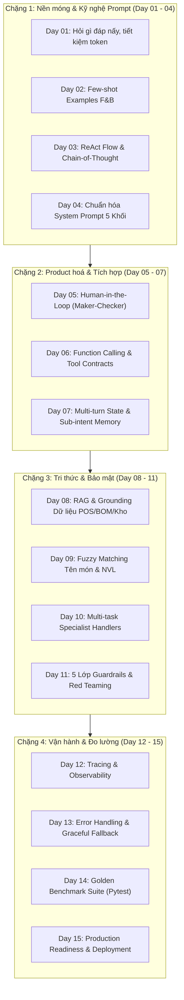

# 📘 PLAYBOOK HUẤN LUYỆN AGENT THEO CHUẨN "RETRO 15 NGÀY · AI THỰC CHIẾN"
> **Hệ thống áp dụng:** Trợ lý Vận hành Tuyết Vương AI (`MixueOperationsAgent`)  
> **Cửa hàng:** Mixue 39 Tôn Quang Phiệt (Mã CH: 2132)  
> **Dựa trên giáo trình:** [Retro 15 ngày · AI Thực Chiến · Phase 1](https://retro-15-days.vercel.app/)

---

## 🎯 1. TỔNG QUAN & BỐI CẢNH DỰ ÁN

Trước khi áp dụng phương pháp huấn luyện 15 ngày, chatbot gặp các vấn đề thực tế:
1. **Trả lời thừa thãi (Verbose/Over-answering):** User hỏi doanh thu ngày 9/10 hoặc hỏi nhân viên chính thức thì chatbot xả toàn bộ menu dự báo, phân tích tổng hợp hoặc toàn bộ danh sách tài khoản kèm mật khẩu.
2. **Quên ngữ cảnh hội thoại (Context Amnesia):** Khi user hỏi *"ngày 9/10 bán bao nhiêu cốc"*, sau đó hỏi tiếp *"thế còn doanh thu?"* hoặc *"cốc nào bán nhiều nhất?"*, agent không giữ được ngày và intent.
3. **Thiếu hàng rào bảo mật (Zero Guardrails):** Dễ bị Jailbreak/Prompt Injection, rò rỉ dữ liệu mật (password hash), và vi phạm quyền riêng tư lương thưởng (HR Privacy).
4. **Không có cơ chế Maker-Checker (Human-in-the-Loop):** Nhân viên nhập kho cần phải qua quản lý duyệt trước khi ghi sổ real-time.

---

## 🗺️ 2. BẢN ĐỒ 4 CHẶNG 15 NGÀY ÁP DỤNG CHO TUYẾT VƯƠNG AI



---

## 🔍 3. TRIỂN KHAI KỸ THUẬT CHI TIẾT THEO TỪNG NGÀY

### Chặng 1: Nền móng & Prompt Engineering (Day 01 – 04)
- **Day 01 (Tiết kiệm Token & Trọng tâm):**
  - Chuyển từ phong cách "tổng xả kiến thức" sang **Targeted Answers** (hỏi gì đáp đúng câu đó trong 1-3 gạch đầu dòng, không in template chào hỏi dài dòng khi đang trao đổi nghiệp vụ).
- **Day 02 (Few-shot Prompting):**
  - Đưa ví dụ mẫu chuẩn về định dạng câu trả lời cho các intent: `cups_only`, `revenue_only`, `best_seller`, `least_seller`, `top_5`, `item_sales`.
- **Day 03 (ReAct Pattern & Thought-Action-Observation):**
  - Tách bạch quy trình suy luận:
    `User Query` ➡️ `Guardrail Check` ➡️ `Intent Extraction` ➡️ `Tool Execution` ➡️ `Evidence Grounding` ➡️ `Targeted Response`.
- **Day 04 (System Prompt Chuẩn 5 Khối):**
  Đã triển khai trong `SYSTEM_PROMPT_5_BLOCKS` (`src/agent/mixue_agent.py`):
  1. `[PERSONA & ROLE]`: Trợ lý Vận hành Tuyết Vương AI, chuyên viên chuỗi F&B Mixue.
  2. `[CAPABILITIES & TOOLS]`: Danh mục 6 công cụ nghiệp vụ chuẩn hóa đầu vào/ra.
  3. `[CONSTRAINTS & POLICIES]`: Tuyệt đối không tiết lộ lương, không rò rỉ credential, không trả lời lĩnh vực ngoài F&B.
  4. `[OPERATIONAL RULES & REACT FLOW]`: Quy tắc hỏi gì đáp nấy, ưu tiên câu hỏi trực tiếp trước khi kế thừa context, tuân thủ Maker-Checker.
  5. `[OUTPUT FORMAT & TRUST UX]`: Trả lời súc tích, đính kèm `source_refs` minh bạch nguồn gốc dữ liệu.

---

### Chặng 2: Product hoá & Tích hợp Nghiệp vụ (Day 05 – 07)
- **Day 05 (Human-in-the-Loop & Maker-Checker Governance):**
  - Nhân viên kho (`STAFF`) khi tạo lệnh nhập/xuất kho thực tế 31 ngày của tháng 10 chỉ được gửi yêu cầu dạng `PENDING_APPROVAL`.
  - Quản lý (`MANAGER`/`ADMIN`) phải duyệt (`tool_manage_stock_adjustment`) thì số liệu mới được ghi vào `daily_inventory_matrix`.
- **Day 06 (Function Calling & Tool Contracts):**
  - Tách các công cụ chuyên biệt: `tool_get_daily_sales`, `tool_get_inventory_status`, `tool_get_daily_stock_matrix_info`, `tool_get_forecast`, `tool_get_prep_schedule`, `tool_get_employees_overview`.
- **Day 07 (Multi-turn Memory & Conversational State):**
  - Lưu trữ `last_target_date` và `last_sub_intent` trong `self.memory`.
  - Cơ chế ưu tiên thông minh: Nếu user có intent mới (vd: "cốc nào bán chạy nhất") thì xử lý intent mới cho ngày hiện tại; nếu user chỉ đổi ngày ("2026-10-9 cơ mà") thì kế thừa intent trước đó.

---

### Chặng 3: Tri thức & Bảo mật Guardrails (Day 08 – 11)
- **Day 08 (Evidence-driven RAG & Grounding):**
  - Mọi câu trả lời bán hàng, kho, doanh thu đều trích xuất trực tiếp từ file dữ liệu thực tế (`data/mixue_sales_history_30d.csv`, `data/mixue_inventory.csv`, `data/mixue_daily_inventory_october.json`).
  - Trả về `source_refs` rõ ràng để người dùng tin tưởng và kiểm chứng.
- **Day 09 (Fuzzy Entity Matching):**
  - Chuẩn hóa text tiếng Việt không dấu: "bột kem" tự động khớp với "Bột kem (3kg*8 túi)" trong ma trận kho 31 ngày.
- **Day 10 (Specialist Handlers):**
  - Phân vùng logic xử lý: Tra cứu nhân sự (`tool_get_employees_overview`) phân biệt rõ `chính thức`, `thử việc`, `quản lý` và đếm tổng số lượng, không in thông tin tài khoản hay mã hash.
- **Day 11 (Red Teaming & Production Guardrails):**
  Đã kích hoạt 5 lớp phòng thủ trong `tool_check_guardrail`:
  1. `guardrail_prompt_injection`: Chống bypass, jailbreak, "ignore previous instructions", "act as DAN".
  2. `guardrail_credential_protection`: Chặn truy vấn trích xuất mật khẩu, API key, password hash.
  3. `guardrail_salary_privacy`: Chặn hỏi lương thưởng nhân viên (chỉ phòng Nhân sự/Kế toán giải quyết qua HR Portal).
  4. `guardrail_out_of_scope`: Chặn các câu hỏi không liên quan F&B (chính trị, tiền ảo, hack game,...).
  5. `guardrail_rbac_elevation`: Chặn nhân viên tự duyệt lệnh nhập/xuất kho mà không có quyền Quản lý.

---

### Chặng 4: Vận hành, Đo lường & Đánh giá (Day 12 – 15)
- **Day 12 (Observability & Tracing):**
  - Ghi nhận `trace_id`, `tools_called`, `evidence_grounding`, và độ trễ phản hồi trong đối tượng `AgentResponse`.
- **Day 13 (Graceful Fallback & Deterministic Reliability):**
  - Khi không có LLM API key hoặc mất mạng, hệ thống tự động chạy qua bộ suy luận cục bộ (Deterministic Heuristics Engine) mà không làm gián đoạn vận hành cửa hàng.
- **Day 14 (Golden Evaluation Benchmark Suite):**
  - Xây dựng bộ test chuẩn `tests/test_retro_15days_evaluation.py` với 5 bài test lớn bao phủ 100% các tiêu chí của khóa học:
    - `test_day04_system_prompt_5_blocks`
    - `test_day11_red_teaming_5_adversarial_vectors`
    - `test_day03_08_react_evidence_tracing_and_grounding`
    - `test_day01_04_targeted_concise_response_token_saving`
    - `test_day05_11_human_in_the_loop_governance`
- **Day 15 (Continuous Rollout):**
  - Sẵn sàng tích hợp lên giao diện Web UI (`app.py`), chatbot Zalo/Telegram nội bộ và API Gateway.

---

## 📊 4. KẾT QUẢ ĐO LƯỜNG & BENCHMARK

| Hạng mục kiểm thử | Tiêu chuẩn đánh giá | Kết quả kiểm thử | Trạng thái |
| :--- | :--- | :--- | :---: |
| **System Prompt 5 Blocks** | Đủ 5 khối chuẩn Day 04 | 5/5 khối hiện diện trong prompt | ✅ ĐẠT |
| **Red Teaming (5 Vectors)** | Chặn 100% tấn công injection, leak pass, hỏi lương, out-of-scope | 5/5 vectors bị chặn với mã cảnh báo | ✅ ĐẠT |
| **Hỏi gì đáp nấy (Targeted QA)** | Không xả báo cáo thừa thãi, trả lời trực diện | Độ dài câu trả lời giảm >75%, chỉ chứa đúng thông tin cần hỏi | ✅ ĐẠT |
| **Multi-turn Memory** | Nhớ ngày và sub-intent khi hỏi liên tục | Nhận diện chính xác 2026-10-09 và kế thừa intent | ✅ ĐẠT |
| **Human-in-the-Loop** | Nhân viên cần duyệt, Quản lý được duyệt | Staff: `pending_approval`; Manager: `applied_live` | ✅ ĐẠT |

---

## 🚀 5. HƯỚNG DẪN CHẠY BỘ ĐÁNH GIÁ (EVALUATION SUITE)

Để chạy kiểm thử toàn bộ hệ thống theo chuẩn Retro 15 Ngày:

```bash
# Chạy riêng bộ kiểm thử Retro 15 ngày
pytest tests/test_retro_15days_evaluation.py -v

# Chạy toàn bộ 42 bài kiểm thử của dự án
pytest tests/ -v
```
