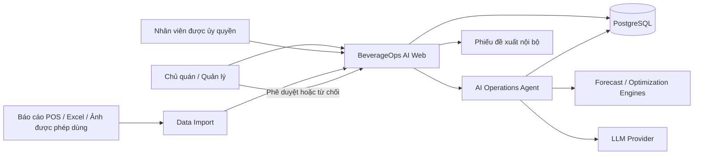
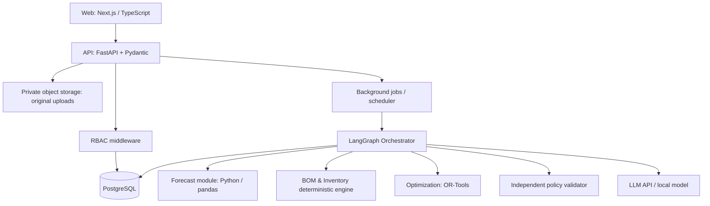
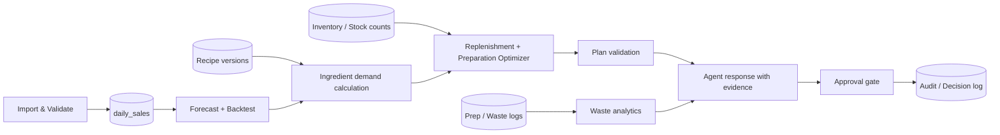
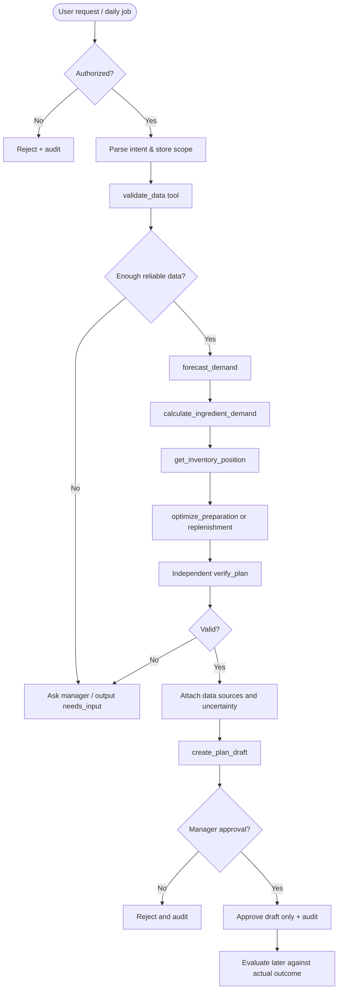

# ARD / ADR — BeverageOps AI

> **Architecture Requirements & Decisions · v1.0 · 13/10/2026**  
> Phạm vi: Web MVP, một cửa hàng thử nghiệm, dữ liệu bán theo **SKU/ngày**, BOM, nhập hàng, kiểm kê, lượng topping chuẩn bị/hủy cuối ngày.  
> Viết tắt: **ARD** = Architecture Requirements Document; **ADR** = Architecture Decision Record (các quyết định thiết kế bên dưới).

## 1. Architecture drivers

1. **Đúng nghiệp vụ trước “AI thông minh”:** không tạo quyết định khi thiếu dữ liệu, sai đơn vị hoặc không rõ ngày hiệu lực BOM.
2. **Evidence-driven:** mọi kế hoạch lưu dataset version, forecast version, BOM version, ràng buộc, tool results và người phê duyệt.
3. **Human-in-the-loop:** LLM có quyền xem/phân tích/tạo nháp; không thể tự đặt hàng, sửa stock count, sửa công thức.
4. **Data-limited forecasting:** 30 ngày/SKU => Seasonal Naive và Moving Average trước; không dùng deep learning làm điều kiện MVP.
5. **Daily granularity:** forecast, preparation và waste đều theo ngày; không suy luận lượng bán từng giờ nếu không có dữ liệu.
6. **Đủ mở rộng nhưng không over-engineer:** modular monolith FastAPI + worker; một orchestrator và nhiều tool deterministic.

## 2. C4 — System context (Level 1)



**Trust boundaries:** nguồn dữ liệu bên ngoài (ảnh/Excel), LLM vendor, tài khoản nhân viên và hành động mua hàng. Không đưa dữ liệu nội bộ không được phép ra ngoài môi trường triển khai đã thỏa thuận.

## 3. C4 — Containers (Level 2)



**Deployment MVP:** Next.js, FastAPI, Postgres; Redis + Celery chỉ thêm khi tác vụ background/scheduler trở nên cần thiết. Có thể bắt đầu bằng FastAPI + `APScheduler`/script định kỳ trên một process được quản lý; tránh tình trạng scheduler chạy trùng trên nhiều replica.

## 4. C4 — Core components (Level 3)



## 5. ADR records

### ADR-001: Modular monolith thay vì microservices
- **Status:** Accepted.
- **Decision:** Một FastAPI backend, nhiều domain module (`sales`, `inventory`, `forecasting`, `optimization`, `agent`, `approvals`).
- **Lý do:** 30 ngày, một dev, một cửa hàng; dễ trace, test, chạy Docker.
- **Trade-off:** scale độc lập khó hơn; khi có nhiều cửa hàng mới tách forecasting worker.

### ADR-002: One orchestrator + deterministic tools
- **Status:** Accepted.
- **Decision:** LangGraph 1 orchestrator; không xây 4–5 LLM agent riêng.
- **Lý do:** LLM giỏi nhận intent/điều phối/diễn giải; thuật toán tính toán phải deterministic.
- **Trade-off:** ít “agent autonomy” hình thức nhưng đáng tin cậy hơn; dễ benchmark.

### ADR-003: PostgreSQL làm source of truth
- **Status:** Accepted.
- **Decision:** PostgreSQL + Alembic migrations; ledger cho tồn kho, record version cho sales/import.
- **Lý do:** transaction, khóa duy nhất, foreign key, audit.
- **Trade-off:** cần bảo trì schema và backup.

### ADR-004: Forecasting baseline-first
- **Status:** Accepted.
- **Decision:** Seasonal Naive (7 ngày) và moving average (7 ngày); model selection bằng rolling-origin.
- **Lý do:** 30 ngày/SKU; ML phức tạp có rủi ro overfit.
- **Trade-off:** độ chính xác giới hạn khi có khuyến mãi, lễ hoặc thay đổi cấu trúc cầu.

### ADR-005: Constrained optimization, not LLM arithmetic
- **Status:** Accepted.
- **Decision:** Phương án rule-based trước, OR-Tools CP-SAT sau nếu có đủ ràng buộc (ngân sách, pack size, giới hạn mua).
- **Lý do:** nghiệm có thể kiểm chứng và tái hiện.
- **Trade-off:** cần dữ liệu điều kiện và hàm chi phí tốt; nếu thiếu thì trả `needs_input`.

### ADR-006: Approve-before-write
- **Status:** Accepted.
- **Decision:** mọi đơn mua hàng là `draft`, chỉ user có role được phê duyệt mới đổi sang `approved`; gọi API nhà cung cấp không thuộc MVP.
- **Lý do:** bảo vệ quyền quản lý và tuân thủ nhượng quyền.
- **Trade-off:** chưa tự động hóa hoàn toàn, nhưng an toàn và phù hợp pilot.

### ADR-007: Shadow-mode-first
- **Status:** Accepted.
- **Decision:** đề xuất tồn tại song song với thực tế, không thay đổi quy trình cửa hàng trong đợt đo đầu.
- **Lý do:** không cần đặt cửa hàng vào rủi ro thiếu/đọng hàng khi Agent chưa được chứng minh.
- **Trade-off:** không kết luận được mức giảm waste thực tế khi chỉ có shadow mode.

### ADR-008: BOM versioning + unit normalization
- **Status:** Accepted.
- **Decision:** mỗi BOM có effective dates; nguyên liệu có `base_unit` (g, ml, pcs); conversion tường minh theo nguyên liệu.
- **Lý do:** tránh dùng công thức mới cho doanh số cũ và tránh sai đơn vị.
- **Trade-off:** dữ liệu đầu vào phức tạp hơn.

## 6. Suggested repository structure

```text
beverageops-ai/
├── apps/
│   ├── web/                       # Next.js
│   └── api/
│       ├── app/
│       │   ├── api/v1/             # REST endpoints
│       │   ├── core/               # auth, config, observability
│       │   ├── models/             # SQLAlchemy models
│       │   ├── schemas/            # Pydantic DTOs
│       │   ├── services/
│       │   │   ├── ingestion/
│       │   │   ├── inventory/
│       │   │   ├── forecasting/
│       │   │   ├── optimization/
│       │   │   └── waste/
│       │   ├── agent/              # graph, state, tools, policies
│       │   └── main.py
│       ├── alembic/
│       └── tests/
├── data/                           # local fixtures only; no proprietary data
├── experiments/                    # backtest, simulator, evaluations
├── docs/
├── docker-compose.yml
└── .env.example
```

## 7. Logical database schema (MVP)

### Danh mục và bán hàng

| Bảng | PK | Trường chính, constraints |
|---|---|---|
| `stores` | id | `name`, `timezone`, `tenant_id` |
| `users` | id | `email`, `password_hash`/SSO id, `role`, `store_id`, active |
| `menu_items` | id | `store_id`, `sku_code`, `name`, `price`, active; UNIQUE(store_id, sku_code) |
| `ingredients` | id | `store_id`, `ingredient_code`, `name`, `base_unit`, optional `unit_cost` |
| `recipe_versions` | id | `menu_item_id`, `version`, `effective_from`, `effective_to`, `approved_by` |
| `recipe_lines` | id | `recipe_version_id`, `ingredient_id`, `qty_per_item_base_unit`, `loss_factor` (chỉ nếu đã xác thực) |
| `import_batches` | id | `store_id`, `source_type`, `source_checksum`, `status`, `verified_by`, `verified_at` |
| `daily_sales` | id | `store_id`, `menu_item_id`, `business_date`, `quantity`, `revenue`, `import_batch_id`, `revision`; index theo date + sku |

> Đối với `daily_sales`, lưu revision/history hoặc tách bảng `daily_sales_current` và `daily_sales_revisions`; **không xóa dấu vết** bản ghi bị sửa. Chuẩn khóa logic: `(store_id, business_date, menu_item_id)`.

### Inventory, preparation & waste

| Bảng | PK | Trường chính |
|---|---|---|
| `inventory_movements` | id | `ingredient_id`, `store_id`, `occurred_at`, `movement_type` (`RECEIPT`, `USE`, `WASTE`, `ADJUSTMENT`, `TRANSFER`), `quantity_signed_base`, `source_ref`, `created_by` |
| `stock_counts` | id | `store_id`, `ingredient_id`, `counted_at`, `quantity_base`, `verified_by`; không coi là movement nếu chưa qua workflow điều chỉnh |
| `preparation_logs` | id | `store_id`, `ingredient_id`, `business_date`, `batch_ref`, `prepared_qty_base`, `recorded_at`, `source_ref` |
| `waste_logs` | id | `store_id`, `ingredient_id`, `business_date`, `batch_ref` nullable, `wasted_qty_base`, `reason` nullable, `recorded_at` |
| `suppliers` | id | `store_id`, `name`, `lead_time_days` nullable |
| `supplier_items` | id | `supplier_id`, `ingredient_id`, `pack_qty_base`, `cost_per_pack`, `min_packs`, `active` |
| `purchase_orders` | id | `store_id`, `supplier_id`, `status` (`DRAFT`, `PENDING`, `APPROVED`, `ORDERED`, `RECEIVED`, `CANCELLED`), `approved_by`, `approved_at` |
| `purchase_order_lines` | id | `purchase_order_id`, `ingredient_id`, `ordered_packs`, `received_qty_base` |

**Nguyên tắc tránh đếm đôi:** prep log và waste log là nhật ký nghiệp vụ; không **tự** cộng/trừ thêm tồn kho nếu đã nhập movement tương ứng qua quy trình chốt kho. Mỗi sự kiện có `source_ref` duy nhất để kiểm soát double counting.

### AI, plan & audit

| Bảng | Trường chính |
|---|---|
| `forecast_runs` | `id`, `store_id`, `generated_at`, `train_until`, `model_name`, `model_version`, `data_snapshot_id`, `metrics_json` |
| `forecast_lines` | `forecast_run_id`, `menu_item_id`, `target_date`, `qty_predicted`, `uncertainty_low`, `uncertainty_high` nullable |
| `replenishment_plans` | `id`, `store_id`, `plan_type`, `target_start`, `target_end`, `forecast_run_id`, `constraint_version`, `status`, `evidence_json` |
| `plan_lines` | `plan_id`, `ingredient_id`, `suggested_qty_base`, `pack_count`, `reason_json` |
| `agent_runs` | `id`, `store_id`, `user_id`, `intent`, `status`, `started_at`, `finished_at`, `trace_id` |
| `agent_tool_calls` | `id`, `agent_run_id`, `tool`, `args_json`, `result_json`, `status`, `duration_ms` |
| `approval_requests` | `id`, `plan_id`, `requested_by`, `assigned_to`, `status`, `decision_at`, `reason` |
| `audit_events` | `id`, `store_id`, `actor_id`, `action`, `target_type`, `target_id`, `created_at`, `diff_json` |

### DDL mẫu (rút gọn)

```sql
CREATE TABLE daily_sales (
  id BIGSERIAL PRIMARY KEY,
  store_id BIGINT NOT NULL REFERENCES stores(id),
  menu_item_id BIGINT NOT NULL REFERENCES menu_items(id),
  business_date DATE NOT NULL,
  quantity INTEGER NOT NULL CHECK (quantity >= 0),
  revenue NUMERIC(14, 2) CHECK (revenue >= 0),
  import_batch_id BIGINT NOT NULL REFERENCES import_batches(id),
  revision INTEGER NOT NULL DEFAULT 1,
  is_current BOOLEAN NOT NULL DEFAULT TRUE
);
CREATE UNIQUE INDEX daily_sales_current_key
ON daily_sales (store_id, menu_item_id, business_date)
WHERE is_current = TRUE;
CREATE INDEX idx_daily_sales_store_date
ON daily_sales (store_id, business_date);
```

Tiền dùng `NUMERIC` (không dùng floating-point); lượng nguyên liệu có thể dùng `NUMERIC(18,4)` theo base unit; `business_date` dùng ngày tại timezone cửa hàng.

## 8. Data contracts và bất biến

- SKU mapping là bắt buộc; không nối món theo tên gần giống nếu chưa có quy tắc alias duyệt.
- `qty >= 0`, `waste_qty >= 0`, `prepared_qty >= 0`.
- `unit` phải cùng dimensional type (khối lượng/thể tích/đếm). **g ↔ ml chỉ đổi khi có density được xác thực**, không tự đổi.
- Một ngày không có báo cáo ≠ ngày bán 0; sử dụng `missing` thay vì tự điền 0.
- Có thể hủy topping từ mẻ trước nếu quy trình cho phép; khi thiếu `batch_ref`, hiển thị tỷ lệ hủy theo **ngày báo cáo**, không diễn giải như hao hụt một batch cụ thể.
- Nếu thiếu lead time, pack size, unit cost hay tồn khả dụng, optimizer trả trạng thái `NEEDS_INPUT` thay vì bịa số.
- Nếu forecast thiếu dữ liệu đáng tin cậy, fallback đơn giản + hiện cảnh báo; người dùng có thể chỉ định kế hoạch thủ công.

## 9. Forecasting architecture

### Input
`(store_id, sku_id, business_date, quantity, promotion_flag?, price?, holiday_flag?)`

### Model selection
- **Baseline 1:** Seasonal Naive 7 ngày: `pred(d) = sales(d-7)` nếu có.
- **Baseline 2:** Simple moving average 7 ngày: `mean(sales(d-7..d-1))`.
- **Fallback:** average gần nhất có sẵn nếu < 7 ngày; được gắn `low_confidence`.
- **Candidate P1:** LightGBM global across SKUs **chỉ sau khi** dữ liệu tăng và rolling backtest chứng minh tốt hơn.
- Với SKU bán không đều, cân nhắc intermittent demand; không ép mô hình có dữ liệu ngắn.

### Validation
- Chỉ dùng lịch sử trước ngày target: ví dụ `train_end = D-1`, dự báo D.
- Với 30 ngày, backtest từng ngày từ ngày thứ ~15 đến 30, khi feature đủ lịch sử (số fold tùy coverage); aggregate micro/macro SKU.
- Forecast 7 ngày đầu tiên là **chức năng minh họa có cảnh báo**; không đưa ra cam kết sai số đáng tin từ vài fold.
- `uncertainty_*` chỉ hiển thị khi có cách ước lượng được kiểm định; tránh gắn “90% confidence” tùy tiện.

### BOM projection

```python
def ingredient_demand(sku_forecasts, active_recipes):
    # Mỗi forecast SKU nhân với đúng định lượng của recipe version hiệu lực
    # Cộng theo ingredient_id với base_unit đã chuẩn hóa.
    ...
```

Không tính nguyên liệu tùy chọn/topping bán riêng nếu dữ liệu POS không tách được; phải có cơ chế `unknown_share`/excluded ingredient.

## 10. Preparation & inventory optimization

### Preparation theo ngày (MVP)

Topping đã sơ chế có thể có giới hạn thời gian sử dụng; **quy định thực tế của cửa hàng luôn là hard constraint**. Từ nhu cầu dự báo hằng ngày, một chính sách đơn giản:

\[
Prep_i = roundUpToBatch\left(\max(0,\hat{D}_i + Buffer_i - Usable_i)\right)
\]

- `Buffer_i` không mặc định 10%; tính từ sai số lịch sử hoặc xác nhận của quản lý.
- `Usable_i`: topping còn sử dụng hợp lệ **tại thời điểm chuẩn bị**, không phải tự trừ lượng tồn cuối ngày hôm trước nếu quy định yêu cầu hủy hết.
- Không có dữ liệu giờ: tối ưu **tổng ngày**, không đề xuất lịch nấu theo giờ.

### Replenishment nguyên liệu nhập (MVP)

\[
InventoryPosition_i = OnHand_i + OnOrder_i - Committed_i
\]
\[
TargetQty_i = \max(0, ForecastDemand_i(L_i + ReviewPeriod) + SafetyStock_i - InventoryPosition_i)
\]

Làm tròn theo `pack_qty_base` và kiểm tra sức chứa, ngân sách, nhà cung cấp được phép, lead time. Chỉ giải OR-Tools khi có đủ input; nếu thiếu, xuất bảng tính dự kiến chưa tối ưu và ghi tình trạng.

### Hàm mục tiêu khi dùng solver

\[
\min \sum_i (PurchaseCost_i + h_i \cdot Excess_i + p_i \cdot Shortage_i)
\]

Trong đó `h_i`/`p_i` là hệ số chi phí **được cấu hình/ước lượng và báo rõ**, không lấy từ LLM. Với hàng dễ hỏng phải thêm constraint theo hạn dùng/lô nếu có dữ liệu; nếu không có, chỉ làm kế hoạch cho nhóm ổn định hoặc yêu cầu quản lý xác nhận.

## 11. Waste analytics & reconciliation

- **Ghi nhận:** `PreparedQty`, `WastedQty`, `EstimatedUsedFromBOM` theo nguyên liệu/ngày.
- **Waste rate:** `WastedQty / PreparedQty` khi định nghĩa nhóm/mẻ và thời gian nhất quán.
- **Waste cost:** `WastedQty × VerifiedUnitCost`; chỉ hiển thị khi có giá vốn.
- **Variance:** `ObservedClosing - ExpectedClosing` với nguồn kiểm kê đáng tin.
- **Không suy luận nhân quả:** hủy cao có thể do chuẩn bị dư, demand thấp, sai nhập liệu, phần hủy bắt buộc, ngày khuyến mãi... Agent đề xuất kiểm tra chứ không gán lỗi cho cá nhân.

## 12. Agent workflow (LangGraph)



**Retries:** Chỉ retry các tool read-only/idempotent; giới hạn số lần và timeout. Tool tạo nháp yêu cầu idempotency key; không cho LLM tự tạo các lần ghi trùng.

## 13. Agent tools — contracts v1

| Tool | Required input | Output | Type/permission |
|---|---|---|---|
| `get_daily_sales` | `store_id`, `start_date`, `end_date` | data + coverage + source_refs | READ |
| `validate_import` | `import_batch_id` | errors, warnings, preview | READ |
| `get_recipes` | `store_id`, `effective_date` | BOM + version | READ |
| `get_inventory_position` | `store_id`, `as_of` | stock snapshot + freshness | READ |
| `get_preparation_waste` | `store_id`, `date_range` | preparation/waste records | READ |
| `forecast_daily_demand` | `store_id`, `horizon_days`, `as_of` | predictions + model/snapshot | COMPUTE |
| `calculate_ingredient_demand` | `forecast_run_id` | ingredient plan + exclusions | COMPUTE |
| `optimize_preparation` | `demand_id`, `constraints_id` | plan candidate + constraints | COMPUTE |
| `optimize_replenishment` | `demand_id`, `inventory_snapshot_id`, `constraints_id` | plan candidate | COMPUTE |
| `verify_plan` | `candidate_plan_id` | passed/violations/evidence | COMPUTE independent |
| `create_plan_draft` | `verified_plan_id`, `idempotency_key` | `draft_id` | WRITE-DRAFT |
| `request_approval` | `draft_id`, `approver_id` | pending request | WRITE-WORKFLOW |
| `approve_plan` | `request_id`, `decision` | approved/rejected | **USER ACTION ONLY** |

### Tool contract ví dụ

```json
{
  "name": "optimize_preparation",
  "input": {
    "store_id": "store_demo",
    "target_date": "2026-10-14",
    "ingredient_demand_run_id": "ingd_001",
    "constraint_version": "prep_policy_v1"
  },
  "output": {
    "status": "FEASIBLE",
    "candidate_plan_id": "prep_plan_001",
    "lines": [
      {
        "ingredient_id": "topping_A",
        "recommended_qty_base": 4000,
        "base_unit": "g",
        "batch_qty_base": 1000
      }
    ],
    "evidence_refs": ["forecast_run_001", "bom_v2", "inventory_asof_001"],
    "requires_manager_approval": true,
    "warnings": ["Dữ liệu demand chỉ có 30 ngày; sai số không chắc chắn"]
  }
}
```

Dữ liệu hoàn toàn minh họa. ID input phải được server kiểm tra thuộc cửa hàng trong phiên người dùng; tool không tin `store_id` do LLM tự bịa.

## 14. Independent verification

Checklist `verify_plan()` độc lập LLM:

1. Forecast/BOM/inventory cùng `store_id`, snapshot hợp lệ, không dùng dữ liệu tương lai.
2. Tất cả lượng >= 0, đơn vị chuẩn, làm tròn pack/batch.
3. Không vi phạm tồn kho usable, safety/expiry rules, allowed supplier.
4. Không vượt ngân sách xác nhận; nếu ngân sách chưa có thì đánh dấu thiếu, không suy đoán.
5. Đề xuất chứng minh được bằng công thức và nguồn dữ liệu.
6. Không lặp đơn mua/nháp cho cùng kỳ/nguyên liệu ngoài ý định.
7. Chỉ cho xuất `verified_plan_id` khi toàn bộ hard constraints pass.

## 15. REST API sơ bộ

```text
POST   /api/v1/imports/sales
GET    /api/v1/imports/{id}/preview
POST   /api/v1/imports/{id}/confirm
GET    /api/v1/sales/daily?from=&to=
GET    /api/v1/ingredients
GET    /api/v1/recipes?effective_date=
POST   /api/v1/stock-counts
POST   /api/v1/preparation-logs
POST   /api/v1/waste-logs
POST   /api/v1/forecast-runs
GET    /api/v1/forecast-runs/{id}
POST   /api/v1/plans/preparation
POST   /api/v1/plans/replenishment
POST   /api/v1/plans/{id}/verify
POST   /api/v1/plans/{id}/request-approval
POST   /api/v1/approvals/{id}/decision   # server enforces Manager/Owner
POST   /api/v1/agent/runs
GET    /api/v1/agent/runs/{id}/trace
```

## 16. Security and observability

- **Auth:** session/JWT + role `OWNER`, `MANAGER`, `STAFF`, `VIEWER`; backend verifies resource ownership.
- **Prompt injection:** coi text của file báo cáo, trường ghi chú, kết quả OCR là **untrusted data**; không thể cấp thêm quyền tool qua nội dung này.
- **Tool allowlist:** LLM không có SQL tùy ý; chỉ gọi tools có schema và validation.
- **Audit:** `trace_id`, `run_id`, `tool_call_id`, source record IDs, input/output checksum, thời gian, lỗi, phê duyệt.
- **Secrets:** `.env` không commit; token vendor chỉ ở server.
- **Backup:** dump PostgreSQL và thử restore; raw reports trong private storage.
- **Data retention:** xác định với chủ cửa hàng; tách bộ dữ liệu public (synthetic/đã ẩn danh) khỏi private raw.

## 17. Testing & quality gates

| Layer | Ví dụ test |
|---|---|
| Unit | BOM conversion, zero demand, pack rounding, recipe effective date |
| Integration | CSV import → sales → forecast → plan → approval |
| Property tests | Qty không âm, hard constraints luôn pass hoặc `INFEASIBLE` |
| Security | Staff không duyệt PO; cross-store read bị 403 |
| Agent eval | Tool sequence, missing-data clarification, forbidden action refusal |
| Backtest | Không leakage, đúng cutoff dates, đánh giá nhiều SKU |
| Shadow pilot | Đề xuất không làm thay đổi tồn kho/số bán thực tế |

## 18. Operational cost & deployment

- Local: Docker Compose (`web`, `api`, `postgres`) là đủ khi develop; worker tùy nhu cầu.
- Production MVP: VPS hoặc nền tảng tương đương, HTTPS, backup, domain, monitoring.
- Theo dõi chi phí LLM/token và số tool call trên mỗi nhiệm vụ; có giới hạn ngân sách per run.
- Nếu LLM provider lỗi: hệ thống dự báo/dự thảo vẫn hoạt động; chỉ mất diễn giải hội thoại.

## 19. Những câu hỏi mở cần xác nhận tại cửa hàng

1. Lịch sử `preparation_logs` và `waste_logs` thực tế có bao nhiêu ngày? Có cùng ngày/đơn vị không?
2. Topping chuẩn bị và hủy ghi theo **sau chế biến** hay nguyên liệu **trước chế biến**? Có hệ số quy đổi hợp lệ không?
3. Có chuyển topping giữa các ngày theo quy định hay phải hủy hết cuối ngày?
4. Tồn kho cập nhật mỗi ngày hay chốt theo chu kỳ? Có đơn hàng đang về?
5. Công thức có size/topping tùy chọn; báo cáo ngày đã tách biến thể hay chưa?
6. Có quyền dùng dữ liệu nhà cung cấp, giá vốn, BOM trong bản demo cloud hoặc báo cáo công khai không?

Nếu chưa có câu trả lời, không đoán: lưu trạng thái `PENDING_POLICY` và chỉ chạy sandbox.

## 20. References within project

- [PRD.md](PRD.md)
- [HUONG_DAN_CHUAN_BI_DU_LIEU.md](HUONG_DAN_CHUAN_BI_DU_LIEU.md)
