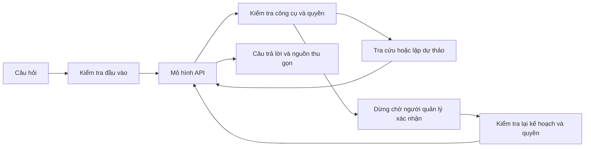

# Tuyết Vương: agent LangGraph

Chat trong dashboard gọi `MixueOperationsAgent.process_query`, sau đó chạy graph
thật trong `src/agent/graph_runtime.py`. Khi bật API, mô hình quyết định gọi công cụ;
dispatcher từ khóa cũ chỉ còn là chế độ cơ bản khi `LLM_ENABLED=false`.

Dự báo và lượng sơ chế hiện dùng chung [luồng sức bán + thời tiết](WEATHER_FORECAST.md).
Định mức đầu ra mẻ có nhãn ước lượng, không được Agent gọi là SOP đã xác nhận.



## Cấu hình

Khóa nằm trong `.env` cục bộ, không đưa vào Git hoặc gửi trong chat. Có thể dùng
`LLM_API_KEY`, hoặc khóa riêng của nhà cung cấp. Chỉ bật cờ gửi dữ liệu khi được
chủ dữ liệu cho phép: nội dung câu hỏi, phần lịch sử được giữ và kết quả công cụ
sẽ được gửi đến nhà cung cấp và có thể qua nhà cung cấp phía sau OpenRouter.

Ví dụ OpenRouter:

```dotenv
LLM_ENABLED=true
LLM_PROVIDER=openrouter
LLM_BASE_URL=https://openrouter.ai/api/v1
OPENROUTER_API_KEY=<điền cục bộ>
LLM_MODEL=openrouter/free
ALLOW_EXTERNAL_DATA_TRANSFER=true
LLM_TIMEOUT_SECONDS=60
LLM_MAX_OUTPUT_TOKENS=1400
AGENT_MAX_TOOL_CALLS=12
AGENT_MAX_MODEL_CALLS=10
AGENT_MAX_RETRIES=2
AGENT_TIMEOUT_SECONDS=120
```

`openrouter/free` dùng để thử nhanh, có thể đổi mô hình giữa các lượt và bị giới
hạn lưu lượng. Muốn đánh giá chất lượng ổn định, đặt một model ID cố định có hỗ
trợ tool calling. Không tự động chuyển sang mô hình trả phí khi gặp lỗi.

Chuyển sang OpenAI: đổi `LLM_PROVIDER=openai`,
`LLM_BASE_URL=https://api.openai.com/v1`, điền `OPENAI_API_KEY` và model ID được
tài khoản hỗ trợ. Xóa `LLM_API_KEY` nếu nó đang chứa khóa của nhà cung cấp trước,
vì biến chung này được ưu tiên hơn khóa riêng.

## Hành vi và ranh giới

- Lời chào/trò chuyện nhẹ không bắt buộc tra dữ liệu. Prompt yêu cầu trả lời ngắn.
  Riêng lời chào đơn giản được trả trực tiếp trong graph (`direct_reply`), không
  gọi API hay đọc dữ liệu, để bảo đảm chỉ có một câu chào.
- Có 18 công cụ có schema; không có SQL tùy ý, đọc file tùy ý hay thực thi shell.
- Các yêu cầu rõ ràng về công thức/SOP và doanh số buộc mô hình gọi công cụ
  khi chưa có kết quả trong lượt. Nếu mô hình bỏ qua hoặc không tra được nguồn
  phù hợp, hệ thống trả `MISSING_EVIDENCE`, không hiển thị nội dung tự suy đoán.
- Với câu hỏi đơn giản về số ly/doanh thu hoặc cách nấu/định lượng/hạn dùng,
  câu trả lời cuối được dựng trực tiếp từ kết quả công cụ để tránh mô hình tự
  thêm thống kê, suy diễn tỷ lệ nguyên liệu hoặc làm sai định lượng. Mô hình
  vẫn chọn công cụ và xử lý các câu hỏi tổng hợp, giải thích, so sánh.
- Công cụ được lọc theo vai trò; mỗi lệnh vẫn kiểm tra quyền tại máy chủ. Mô hình
  không được truyền vai trò hoặc tên người duyệt qua tham số.
- Tham số sai trả lỗi cho mô hình sửa; cả batch sai bị hủy trước khi chạy.
- Công cụ đọc có retry giới hạn; công cụ tạo dự thảo không tự retry và được khử
  trùng trong cùng lượt. Không bảo đảm khử trùng qua lượt mới hoặc crash giữa
  lúc lưu dự thảo và ghi checkpoint.
- Phê duyệt dùng `interrupt`/`Command(resume=...)`. Giao diện cho xem kế hoạch và
  bấm xác nhận/hủy. Khi tiếp tục, kiểm tra lại quyền, mã và nội dung kế hoạch;
  kế hoạch bị thay đổi sau khi mở xác nhận phải được yêu cầu duyệt lại.
- SQLite checkpoint lưu thông điệp, kết quả công cụ và trạng thái chờ duyệt ở
  `data/agent_private/checkpoints.sqlite`, ngoài Git. Namespace tách tài khoản,
  vai trò, cửa hàng và cuộc trò chuyện. Đăng xuất/đổi tài khoản/xóa chat bắt đầu
  một namespace mới; thao tác này không xóa checkpoint cũ khỏi đĩa.
- Chỉ phần lịch sử gần nhất có đầy đủ cặp gọi công cụ/kết quả được gửi tới API.
  Nhật ký `audit.jsonl` lưu mã lượt, trạng thái và tên công cụ; không ghi khóa,
  nội dung câu hỏi hay toàn bộ tham số.
- Lượt gọi mô hình/công cụ và độ dài đầu ra có giới hạn. Timeout HTTP áp dụng
  cho từng request; thời hạn toàn lượt được kiểm tra giữa các node, không ngắt
  cưỡng bức một truy vấn database đang chạy.
- API lỗi được báo rõ; không chuyển âm thầm sang câu trả lời giả lập. Chế độ cơ
  bản được ghi là `offline_rules`, không phải LLM.

## Kiểm thử

```powershell
python -m pytest tests/test_langgraph_agent.py -q
python scripts/check_agent_api.py
```

Pytest tự tắt API từ `.env`, dùng mô hình kiểm thử để chạy graph thật: chu trình
nhiều bước, lỗi tham số, quyền truy cập, ngân sách, retry, tách phiên, lưu SQLite
và dừng/tiếp tục phê duyệt. Script API mặc định chỉ gửi lời chào và phép cộng
với công cụ giả, không kết nối dữ liệu cửa hàng.

Sau khi được cho phép gửi dữ liệu cửa hàng và bật cờ tương ứng:

```powershell
python scripts/check_agent_api.py --with-store-data
```

Kết quả nằm tại `output/agent-review/`. Thử thêm câu hỏi tiếp nối, dữ liệu không
tồn tại và nhiều cách diễn đạt tiếng Việt trước khi chọn model triển khai.

## Phần cần phát triển tiếp

Nhận diện và lịch sử: tên, tài khoản, vai trò, mã cửa hàng lấy từ phiên đăng
nhập được xác thực. “Tôi là ai?” được trả trực tiếp, không cần gọi LLM.
Danh sách chat và toàn bộ tin nhắn hiển thị được lưu trong `conversations.sqlite`
cùng thư mục checkpoint riêng. Quyền sở hữu được gắn với cửa hàng + tài khoản
+ vai trò và kiểm tra khi đọc/chuyển/ghi chat; không dùng tên người dùng làm khóa.
Khởi tạo lại dịch vụ sẽ mở chat gần nhất; chọn lịch sử để mở chat khác. Tạo chat
mới giữ lại chat cũ. Lịch sử LangGraph được khôi phục theo đúng mã chat để tiếp
tục ngữ cảnh. Đây là bộ nhớ trong từng cuộc trò chuyện, chưa phải hệ thống tự
trích xuất sở thích dài hạn xuyên qua mọi chat. LLM vẫn chỉ nhận cửa sổ lịch sử
giới hạn bởi `max_history_messages`; lịch sử hiển thị không bị xóa khi cắt ngữ cảnh.
Giao diện liệt kê tối đa 100 cuộc trò chuyện gần đây cho mỗi phạm vi tài khoản.

Cập nhật 16/10/2026: câu hỏi kết hợp dự báo số ly và thời tiết phải có đủ
hai nhóm nguồn, không coi một công cụ là đủ cho toàn bộ câu hỏi. Câu nối
tiếp ngắn như “còn ngày mai?” kế thừa chủ đề gần nhất và bắt buộc có kết
quả tra mới trong lượt đó. Khi bước tổng hợp API lỗi, chỉ trả kết quả đã
được dựng trực tiếp từ công cụ nếu đủ nguồn; không thay bằng số bịa.
Các câu dự báo một ngày kèm thời tiết được dựng từ hai kết quả cùng ngày,
kể cả mô hình gọi lặp cùng công cụ. Câu so sánh nhiều ngày vẫn giữ tổng hợp
của mô hình, không gộp mất ngày. Nguồn và giới hạn hiển thị gọn; dữ liệu
đầy đủ vẫn nằm trong kết quả công cụ.

Các câu trả lời đơn giản đã có lớp dựng câu trả lời từ dữ liệu, nhưng chưa có
bộ kiểm chứng mọi con số/SOP trong các câu trả lời tổng hợp do LLM sinh.
Chưa tích hợp ảnh/OCR vào graph chat này. Bước tiếp
theo là node nhận ảnh → OCR có độ tin cậy theo trường → màn hình người dùng sửa
và xác nhận → kiểm định → tạo dự thảo nghiệp vụ. Không ghi kho trực tiếp từ OCR.

SQLite phù hợp chạy nội bộ một máy. Trước khi phục vụ nhiều cửa hàng, cần đưa
store ID vào từng truy vấn và kế hoạch, chính sách lưu/xóa checkpoint, mã hóa
dữ liệu riêng và checkpoint backend cho nhiều tiến trình.

Tài liệu đối chiếu: [LangGraph quickstart](https://docs.langchain.com/oss/python/langgraph/quickstart),
[persistence](https://docs.langchain.com/oss/python/langgraph/persistence),
[interrupts](https://docs.langchain.com/oss/python/langgraph/interrupts),
[OpenRouter tools](https://openrouter.ai/docs/guides/features/tool-calling).
