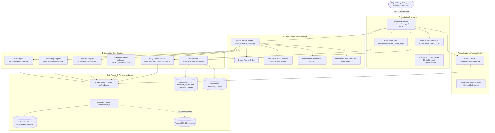

# BÁO CÁO KIỂM TOÁN KIẾN TRÚC HỆ THỐNG (ARCHITECTURE AUDIT)
## HỆ THỐNG: BEVERAGE-OPS AI — CHI NHÁNH MIXUE 39 TÔN QUANG PHIỆT
**Mã tài liệu:** `WB-AUDIT-02-ARCH`  
**Phiên bản:** 2.0.0-PROD-AUDIT  
**Đối tượng:** Toàn bộ cấu trúc thư mục, luồng dữ liệu, ranh giới thành phần và mô hình triển khai

---

## 1. SƠ ĐỒ KIẾN TRÚC HIỆN TẠI (AS-IS ARCHITECTURE)

Hệ thống **BeverageOps AI** hiện tại được tổ chức theo mô hình **Monolith kết hợp Streamlit Runtime**. Tất cả các tầng từ giao diện người dùng, logic phân quyền, thuật toán tối ưu toán học, quản trị AI Agent và truy vấn cơ sở dữ liệu đều chạy chung trong một tiến trình Python đơn nhất.

### 1.1. Sơ đồ Luồng Thành phần Hệ thống (Mermaid Diagram)



### 1.2. Mô hình Luồng Dữ liệu (ASCII Data Flow Architecture)

```
[ BROWSER CLIENT ]
       │  (WebSocket State Sync / HTTP Form Submit)
       ▼
┌────────────────────────────────────────────────────────────────────────┐
│ STREAMLIT PROCESS (Single Python Thread Worker)                        │
│                                                                        │
│  [ app.py ] ─── st.session_state (User, Role, Auth, Page State)       │
│      │                                                                 │
│      ├──► [ auth.py ] ────────── SHA-256 (No Salt)                     │
│      │                                                                 │
│      ├──► [ mixue_agent.py ] ─── 8 Tools / System Prompt / Guardrail   │
│      │         │                                                       │
│      │         ├──► [ forecasting.py ] ── Rolling Backtest (1,872 runs)│
│      │         ├──► [ optimizer.py ] ─── Batch Rounding (1000g/5000ml) │
│      │         ├──► [ validator.py ] ─── Policy Check (ADR-005/006)    │
│      │         └──► [ bom_engine.py ] ── Theoretical BOM Explosion     │
│      │                                                                 │
│      ├──► [ daily_stock_service.py ] ── Maker-Checker Workflow         │
│      │                                                                 │
│      └──► [ shift_service.py ] ── Mock Image OCR / Shift Reports       │
│                 │                                                      │
└─────────────────┼──────────────────────────────────┬───────────────────┘
                  │                                  │
                  ▼                                  ▼
      ┌──────────────────────┐             ┌─────────────────────────┐
      │  SQLAlchemy 2.0 ORM  │             │  MUTABLE JSON STORAGE   │
      │  (src/models.py)     │             │  (data/shift_reports)   │
      └──────────┬───────────┘             └─────────────────────────┘
                 │ (No Pool / Single-thread SQLite)
                 ▼
      ┌──────────────────────┐
      │ SQLite CSDL Cục Bộ   │
      │ data/beverageops.db  │
      └──────────────────────┘
```

---

## 2. PHÂN TÍCH RANH GIỚI THÀNH PHẦN (COMPONENT COUPLING & SEPARATION OF CONCERNS)

### 2.1. Tách biệt giữa Presentation và Business Logic
- **Điểm mạnh:**
  - Logic tính toán thuần túy (BOM, dự báo, tối ưu hóa định lượng) đã được tách thành các module độc lập trong thư mục `src/engine/`. Các class như `BOMEngine`, `ForecastingEngine`, `OptimizerEngine` có thể được import và chạy độc lập qua script hoặc unit test mà không bắt buộc phải có Streamlit runtime.
  - Bộ thẩm định chính sách `IndependentPlanValidator` hoạt động như một lớp kiểm duyệt độc lập (Policy Enforcement Point) tuân theo kiến trúc Zero Trust được mô tả trong tài liệu kiến trúc ADR-005/006.
- **Điểm yếu (Tight Coupling):**
  - Tệp [src/dashboard/app.py](file:///c:/Users/Admin/OneDrive/Desktop/DATN/AI-Agent_mixue/src/dashboard/app.py) dài **1,234 dòng**, đóng vai trò như một **God Controller**. Tệp này trực tiếp chứa logic render UI, kiểm tra quyền truy cập trang, xử lý sự kiện nút bấm, gọi trực tiếp các dịch vụ cơ sở dữ liệu và thậm chí nhúng mã HTML/CSS nội dòng.
  - Quản trị phiên đăng nhập và phân quyền hoàn toàn phụ thuộc vào `st.session_state`. Không có khái niệm Stateless Session hay Token-based Auth (JWT). Nếu người dùng mở nhiều tab trên cùng một trình duyệt hoặc làm mới trang (F5), trạng thái phiên có thể bị reset hoặc xung đột biến toàn cục.

### 2.2. Sự Phân mảnh Lưu trữ (Divergent Storage Dichotomy)
Kiến trúc hệ thống đang tồn tại **hai cơ chế lưu trữ song song không nhất quán**:
1. **Dữ liệu Hoạt động Bán hàng & Danh mục (Relational Database):**
   - Lưu trữ trong SQLite/PostgreSQL qua SQLAlchemy: `menu_items`, `ingredients`, `recipe_bom`, `sales_daily`, `purchases`, `stock_counts`, `topping_daily`, `users`, `daily_stock_movements`.
   - Cơ chế này đảm bảo được tính toàn vẹn tham chiếu khóa ngoại (Foreign Keys) và chỉ mục tìm kiếm (Indexes).
2. **Dữ liệu Chốt ca & Doanh thu Thực tế (Flat File JSON):**
   - Lưu trữ trong [data/shift_reports.json](file:///c:/Users/Admin/OneDrive/Desktop/DATN/AI-Agent_mixue/data/shift_reports.json) qua module [src/engine/shift_service.py](file:///c:/Users/Admin/OneDrive/Desktop/DATN/AI-Agent_mixue/src/engine/shift_service.py).
   - **Hậu quả kiến trúc:** Khi cần đối soát doanh thu giữa POS (trong bảng CSDL `sales_daily`) và sổ chốt ca, hệ thống phải thực hiện đọc file JSON, parse dict rồi truy vấn chéo vào SQL. Không thể thực hiện câu lệnh SQL `JOIN` nguyên tử. Khi có sự cố ghi đè file JSON (như đã phát hiện trong ca kiểm thử thất bại), toàn bộ tính toàn vẹn dữ liệu tài chính bị sụp đổ mà không có cơ chế Rollback.

### 2.3. Khởi tạo Cơ sở dữ liệu tại Import Time (Import-time Side Effects)
Tại các tệp [src/auth.py:25](file:///c:/Users/Admin/OneDrive/Desktop/DATN/AI-Agent_mixue/src/auth.py#L25) và [src/engine/daily_stock_service.py:22](file:///c:/Users/Admin/OneDrive/Desktop/DATN/AI-Agent_mixue/src/engine/daily_stock_service.py#L22):
```python
Base.metadata.create_all(bind=engine)
```
Việc gọi `create_all()` ngay tại cấp độ module (module-level execution) là một anti-pattern nghiêm trọng. Khi bất kỳ script, unit test hay linter nào import module này, ứng dụng lập tức cố gắng kết nối và biến đổi lược đồ cơ sở dữ liệu mà không thông qua cơ chế kiểm soát Migration chuẩn (như Alembic).

---

## 3. CÁC ĐIỂM NGHẼN KIẾN TRÚC (ARCHITECTURAL BOTTLENECK ANALYSIS)

```
┌─────────────────────────────────────────────────────────────────────────────┐
│                       ARCHITECTURAL BOTTLENECKS                             │
├──────────────────────────┬──────────────────────────┬───────────────────────┤
│ Bottleneck               │ Root Cause               │ Impact                │
├──────────────────────────┼──────────────────────────┼───────────────────────┤
│ 1. Sequential Compute    │ 1,872 backtest cycles in │ UI frozen for 14s;    │
│    in Forecasting Engine │ forecasting.py           │ Server thread blocked │
├──────────────────────────┼──────────────────────────┼───────────────────────┤
│ 2. In-Memory Draft Loss  │ draft_plans dict in      │ Plans vanish on app   │
│                          │ mixue_agent.py instance  │ restart or multi-pod  │
├──────────────────────────┼──────────────────────────┼───────────────────────┤
│ 3. Unsafe JSON Write     │ json.dump() without lock │ Race condition;       │
│                          │ in shift_service.py      │ Lost revenue shifts   │
├──────────────────────────┼──────────────────────────┼───────────────────────┤
│ 4. Single-Thread SQLite  │ SQLite WAL disabled;     │ Database locked error │
│                          │ check_same_thread=False  │ under concurrent load │
├──────────────────────────┼──────────────────────────┼───────────────────────┤
│ 5. Monolithic Execution  │ No headless API;         │ Cannot integrate with │
│                          │ UI tied to engines       │ POS / Mobile apps     │
└──────────────────────────┴──────────────────────────┴───────────────────────┘
```

### 3.1. Tính toán Nặng Đồng bộ trong Luồng Phục vụ Giao diện
- Khi người dùng điều hướng vào Tab **Dự báo nhu cầu** hoặc gửi câu hỏi *"Dự báo doanh số ngày mai"* vào Tuyết Vương AI, hàm `forecast_demand(horizon_days=1, model="auto")` được gọi.
- Do chọn `model="auto"`, hệ thống chạy hàm `run_backtest(start_eval_day=15)` lặp qua 16 ngày lịch sử, 39 SKUs và 3 mô hình (16 × 39 × 3 = 1,872 lượt dự báo và tính WAPE).
- Vì toàn bộ tác vụ này chạy đồng bộ (synchronous execution) trên cùng thread xử lý request của Streamlit, máy chủ bị chiếm dụng 100% CPU trên core đó trong suốt 14 giây. Nếu có 3 người dùng cùng bấm nút một lúc, hệ thống sẽ rơi vào trạng thái tê liệt.

### 3.2. Tính Bốc hơi của Bản Ghi Dự thảo (In-Memory Plan Evaporation)
- Tại [src/agent/mixue_agent.py:194](file:///c:/Users/Admin/OneDrive/Desktop/DATN/AI-Agent_mixue/src/agent/mixue_agent.py#L194):
  ```python
  self.draft_plans = {}  # In-memory draft plan store
  ```
- Các kế hoạch sơ chế topping (`PLAN_PREP_...`) và đơn nhập hàng PO (`PLAN_PO_...`) sau khi được tối ưu và thẩm định sẽ được lưu vào dictionary `self.draft_plans` trong RAM.
- **Rủi ro:** Khi tiến trình Streamlit reload (do timeout, restart dịch vụ hoặc deploy phiên bản mới), toàn bộ các bản dự thảo đang chờ Quản lý duyệt sẽ **biến mất vĩnh viễn**. Quản lý khi truy cập vào hệ thống để bấm nút Duyệt sẽ nhận thông báo lỗi: *"Không tìm thấy bản dự thảo kế hoạch"*.

---

## 4. ĐÁNH GIÁ TÍNH SẴN SÀNG MỞ RỘNG (MULTI-STORE SCALABILITY)

Hiện tại, hệ thống được cấu hình cứng (hardcoded) cho duy nhất một cửa hàng:
- Chi nhánh: **Mixue 39 Tôn Quang Phiệt** (Mã CH: `2132`).
- Chuỗi cấu hình và các rule trong [src/agent/mixue_agent.py](file:///c:/Users/Admin/OneDrive/Desktop/DATN/AI-Agent_mixue/src/agent/mixue_agent.py#L158) gắn chặt với danh tính của Quản lý Bùi Văn Quang và Chủ quán Nguyễn Hạnh Chi.
- Bảng `daily_stock_movements` trong [src/models.py:149](file:///c:/Users/Admin/OneDrive/Desktop/DATN/AI-Agent_mixue/src/models.py#L149) **hoàn toàn thiếu cột `store_id`**, trong khi các bảng khác như `sales_daily` và `topping_daily` lại có cột `store_id`.

**Kết luận:** Hệ thống **CHƯA SẴN SÀNG** để triển khai chuỗi đa cửa hàng (Multi-tenant / Multi-store). Nếu mở rộng sang cửa hàng thứ hai, dữ liệu thẻ kho 31 ngày sẽ bị trộn lẫn giữa các cửa hàng.

---

## 5. KIẾN TRÚC MỤC TIÊU ĐỀ XUẤT (TARGET ARCHITECTURE - TO-BE)

Để đáp ứng tiêu chuẩn phần mềm SaaS vận hành chuỗi F&B chuyên nghiệp, kiến trúc cần được tái cấu trúc theo mô hình **Decoupled Three-Tier Architecture**:

```mermaid
graph TD
    subgraph Client Layer
        WebPortal["Web Portal: React / Next.js / Streamlit Client"]
        POSIntegration["POS Machine Webhook / Sync Client"]
        MobileApp["Mobile App cho Quản lý (Approve on Mobile)"]
    end

    subgraph API Gateway & Authentication
        Gateway["API Gateway / Reverse Proxy (Nginx / Traefik)"]
        AuthService["Auth Middleware: JWT Token + RBAC Policies"]
    end

    subgraph Application & Business Services Layer (FastAPI Backend)
        APIServer["FastAPI Application Server (Stateless)"]
        BOMService["BOM & Reconciliation Service"]
        StockService["Stock & Maker-Checker Service"]
        ShiftServiceNew["Shift & POS Audit Service (SQL-backed)"]
        AgentService["Agent Orchestration (LangChain / LangGraph)"]
    end

    subgraph Asynchronous Worker & Task Queue
        CeleryWorker["Background Worker: Celery / RQ"]
        ForecastTask["Heavy Forecasting & Rolling Backtest Task"]
        OCRTask["Async OCR Worker (Tesseract / Vision LLM)"]
    end

    subgraph Shared Cache & Message Broker
        Redis[("Redis: Caching + Session + Celery Broker")]
    end

    subgraph Enterprise Persistence Layer
        PostgreSQL[("PostgreSQL 16 Cluster (Active-Standby)")]
        Alembic["Alembic Database Migrations Engine"]
    end

    ClientLayer --> Gateway
    Gateway --> AuthService
    AuthService --> APIServer
    APIServer --> BOMService
    APIServer --> StockService
    APIServer --> ShiftServiceNew
    APIServer --> AgentService
    APIServer --> Redis
    APIServer --> CeleryWorker
    CeleryWorker --> ForecastTask
    CeleryWorker --> OCRTask
    APIServer --> PostgreSQL
    CeleryWorker --> PostgreSQL
```

### Các Bước Cải Tổ Kiến Trúc Ưu Tiên:
1. **Thống nhất CSDL (Single Source of Truth):**
   Chuyển bảng dữ liệu chốt ca từ `data/shift_reports.json` vào bảng SQL `shift_reports` và `shift_expenses` trong PostgreSQL.
2. **Tách biệt Caching Layer:**
   Áp dụng Redis hoặc Diskcache cho kết quả backtest của `ForecastingEngine`, đảm bảo một chu kỳ backtest chỉ tính một lần mỗi ngày (D+1).
3. **Persist Kế hoạch Dự thảo:**
   Tạo bảng `draft_operational_plans` trong cơ sở dữ liệu để lưu các kế hoạch do AI tạo ra thay vì lưu trong biến RAM `self.draft_plans`.
4. **Bổ sung cột `store_id` vào mọi thực thể:**
   Chuẩn hóa mô hình Multi-tenant bằng cách đưa `store_id` vào `daily_stock_movements`, `users`, `purchases`.
